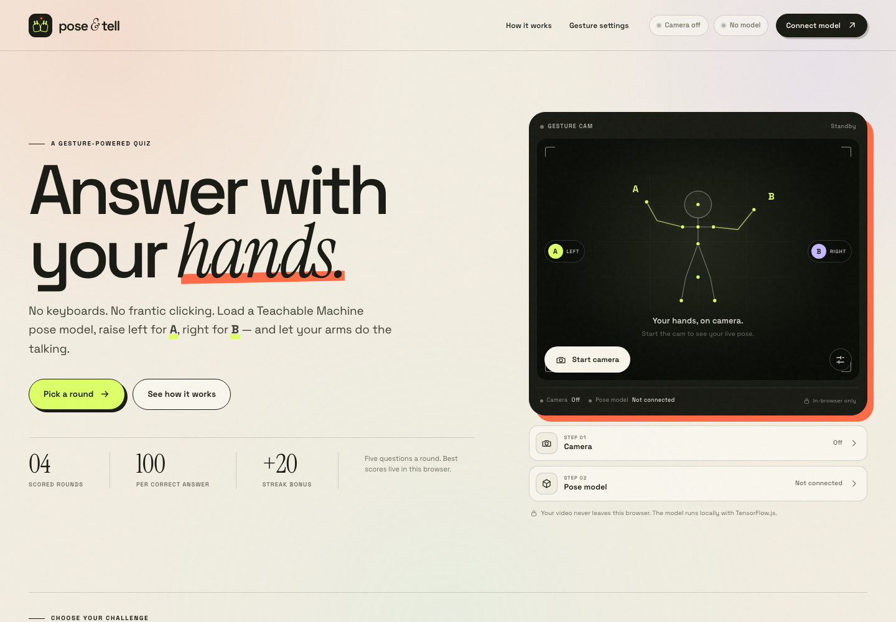

# Pose & Tell

A hands-free trivia game powered by your own **Teachable Machine pose model**. Load a model, connect a webcam, raise one hand for **A** and the other for **B**, and play four scored rounds.



**Live demo:** [mkpc-yaukin.github.io/MKPCTeachableMachine2710](https://mkpc-yaukin.github.io/MKPCTeachableMachine2710/)

The app is a static site — no build step and no server-side code. Video frames stay in the browser; only the model files and the PoseNet engine are fetched over the network.

## Run it

From this folder:

```bash
python3 serve.py
```

Then open **http://127.0.0.1:4173/**.

`serve.py` also tries to open your default browser. If you prefer a different port:

```bash
python3 serve.py --port 4180
```

> A webcam only works from a secure origin. `http://127.0.0.1` and `http://localhost` count as secure; opening `index.html` as a `file://` URL does not.

You can also use any static server, for example:

```bash
python3 -m http.server 4173 --bind 127.0.0.1
```

## Bring a Teachable Machine model

1. Open [Teachable Machine](https://teachablemachine.withgoogle.com/train/pose) and create a **Pose Project**.
2. Train at least **two classes** — for example:
   - `Left hand` (mapped to A)
   - `Right hand` (mapped to B)
   - A `Neutral` / idle class is strongly recommended; without one the model always picks A or B, which can cause accidental answers while you rest.
3. Choose **Export Model → Upload my model** and keep the public share URL, **or** download the model files.
4. In Pose & Tell, click **Connect model** and either:
   - paste the share URL under **From a URL**, or
   - drop the downloaded **`.zip` / folder** under **From local files** (you can also choose the three files: `model.json`, `weights.bin`, `metadata.json`).
5. Review the **Gesture settings**:
   - assign one model class to **A** and another to **B**,
   - map your **No hands / Rest** class to **Rest** (auto-detected when labels mention neutral, idle, rest, no hands, arms down, etc.),
   - set the gesture threshold — raise it if gestures fire while your hands are down,
   - set how long a pose must be held,
   - mirror the camera to match your training setup (on by default).

The model is loaded with TensorFlow.js. Pose tracking uses the PoseNet engine that ships with the Teachable Machine pose library, so the first load needs an internet connection. Once a model is loaded, all classification happens locally in the tab.

## How to play

- Pick one of four rounds: **World Tour**, **Screen Time**, **Brain Sparks**, or **Sound Check**.
- Each round has **5 questions** and two answer options.
- Hold a mapped gesture until the ring fills. Lower your hand before the next question.
- Every correct answer is worth **100 points**. Each consecutive correct answer adds a **+20 streak bonus** (capped at four links), so a perfect round is **700 points**.
- Best scores are saved in `localStorage` in this browser.
- A camera and model are optional: every question can also be answered by click or the **A** / **B** keys, and **N** advances after feedback.

## Privacy

- No video or audio is uploaded, recorded, or sent anywhere.
- The webcam stream is used only on a local `<canvas>` for pose inference.
- Local model files are read with the browser's File API and never leave the tab.
- The camera stops when a round ends, when you leave the round, or when the tab is closed.

## Project layout

```text
index.html                  markup and dialogs
css/styles.css              visual system and responsive layout
js/app.js                   UI state, quiz flow, model picker, scoring
js/pose-engine.js           webcam, pose inference, hold/release state machine
js/utils.js                 URL normalisation, label mapping, file/zip parsing, storage
js/data.js                  quiz sets and scoring rules
vendor/tf.min.js            TensorFlow.js 1.3.1
vendor/teachablemachine-pose.min.js
vendor/fflate.js            zip support for local model imports
assets/fonts/               self-hosted Space Grotesk and Instrument Serif
serve.py                    tiny local server with webcam-friendly headers
```

## Test the gesture rules

```bash
node --test tests/gesture.test.mjs
```

The tests cover three-class label mapping, rest/no-hands suppression, and confidence thresholds.

## Troubleshooting

| Problem | Try this |
| --- | --- |
| Camera won't start | Use `http://127.0.0.1:4173/`, allow the camera in site settings, and close other apps using the webcam. |
| “That's a Teachable Machine image model” | Export a **Pose Project** model, not an Image Project. |
| Gesture never fills the ring | Check the live class confidence in Gesture settings; lower the confidence threshold or hold a clearer pose. |
| Answer fires too easily | Raise the confidence threshold and increase the hold time. |
| Model URL won't load | The model must be public and the host must allow CORS. The Teachable Machine share URL does. |
| Model takes a long time | The PoseNet engine is downloaded on first use. Keep the page online and try a hard refresh if the engine fails. |
| Hands are reversed | Turn **Mirror the camera** off or on to match how the model was recorded; or swap the A / B mapping. |
| Answers fire while resting | Map the “No hands” class as **Rest** in Gesture settings, raise the gesture threshold, or increase the hold time. |

## Browser support

Best in a current Chrome, Edge, Safari, or Firefox on a device with a webcam. WebGL is recommended for smooth pose tracking; if WebGL is unavailable TensorFlow.js can fall back to CPU, which may be slower.

## Deploy

This repository is deployed with GitHub Pages from the `main` branch root. The `.nojekyll` file keeps the static vendor and asset folders untouched.

